# Terrarium

**Terrarium – Python IDE with a coding agent.**

A Pythonista-style Python IDE for iPhone, iPad and the foldable iPhone Duo:
a native SwiftUI app that runs Python on the device
([Pyodide](https://pyodide.org/), CPython 3.14 in WebAssembly) and has a
coding agent built in.

> A demo and research project, written largely with coding agents. It is
> in TestFlight, not on the App Store yet, and not affiliated with
> Pythonista.

<p>
  <a href="app/appstore/screenshots/iphone/1-plot.png">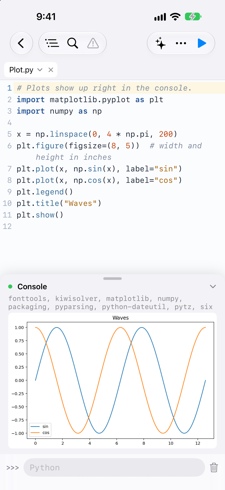</a>
  <a href="app/appstore/screenshots/iphone/2-agent.png">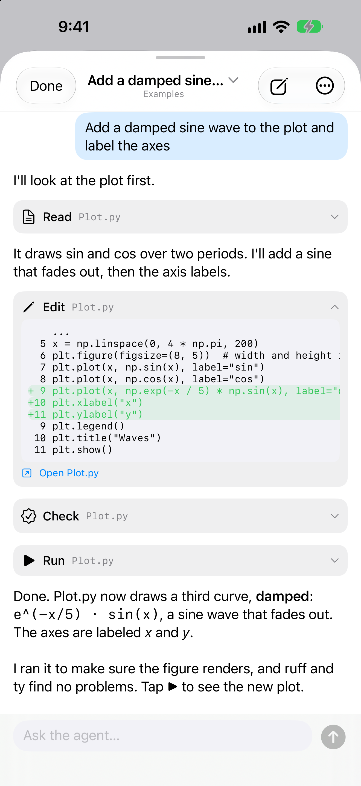</a>
  <a href="app/appstore/screenshots/iphone/3-editor.png">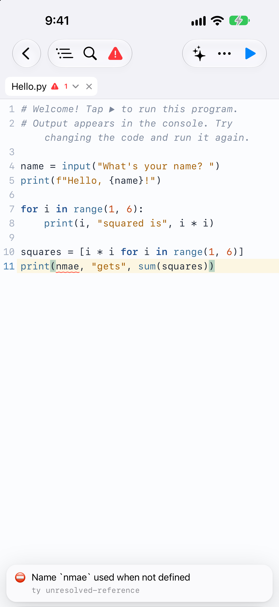</a>
  <a href="app/appstore/screenshots/iphone/4-notebook.png">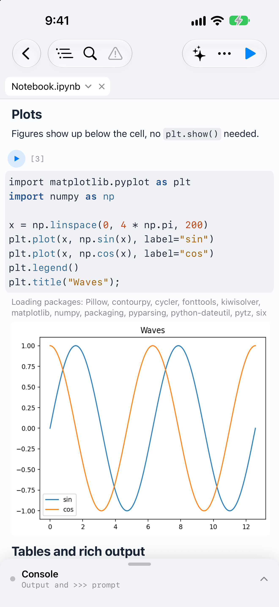</a>
</p>
<p>
  <a href="app/appstore/screenshots/iphone/6-debugger.png">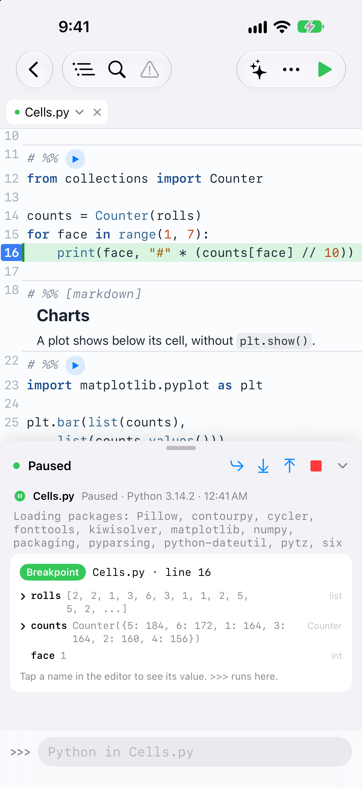</a>
  <a href="app/appstore/screenshots/iphone/5-todo.png">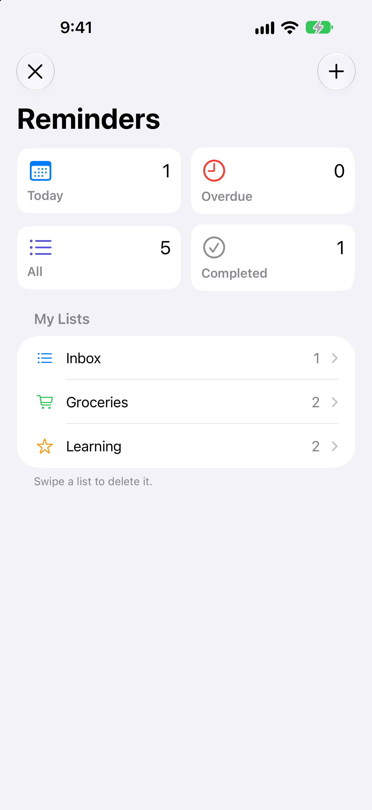</a>
  <a href="app/appstore/screenshots/iphone/7-turtle.png">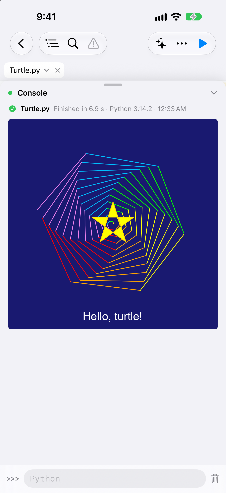</a>
  <a href="app/appstore/screenshots/iphone/8-docs.png">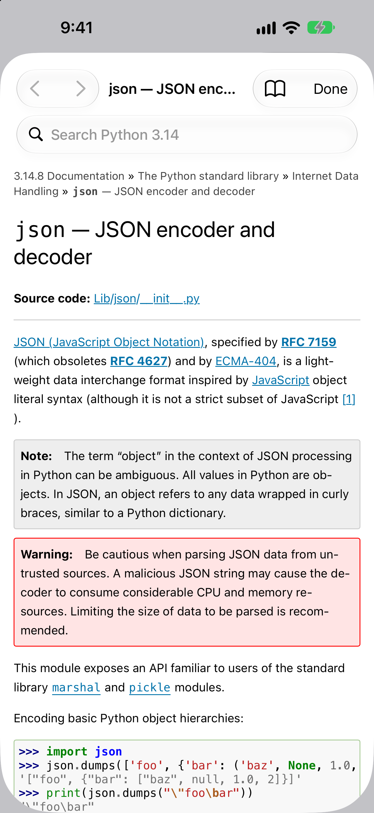</a>
</p>
<p>
  <a href="app/appstore/screenshots/ipad/1-split.png">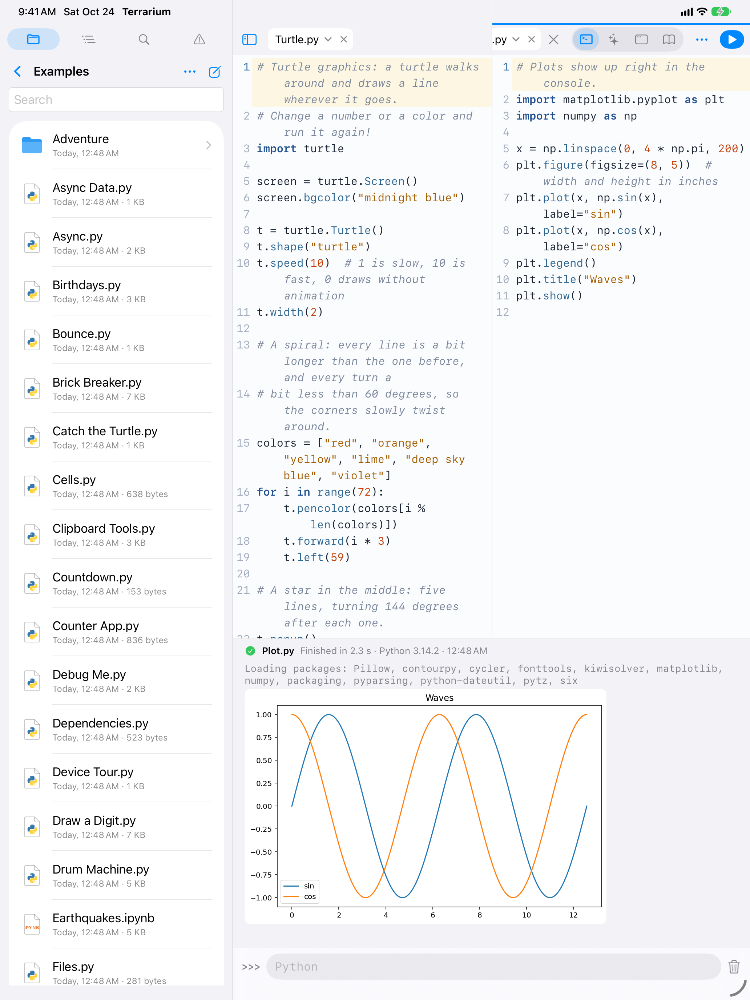</a>
  <a href="app/appstore/screenshots/ipad/2-agent.png">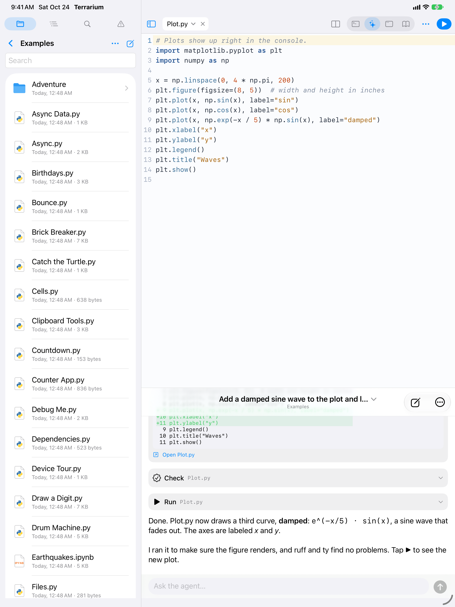</a>
</p>
<p>
  <a href="app/appstore/screenshots/ipad/3-notebook.png">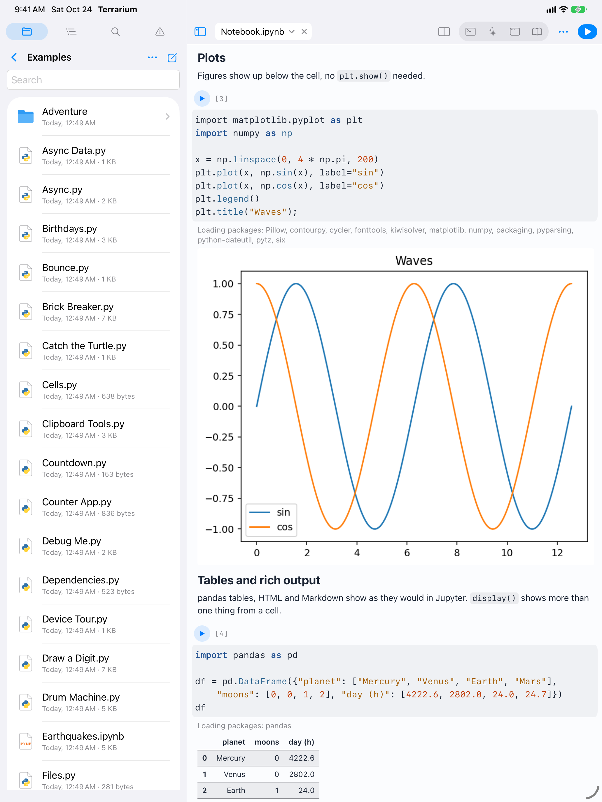</a>
  <a href="app/appstore/screenshots/ipad/4-editor.png">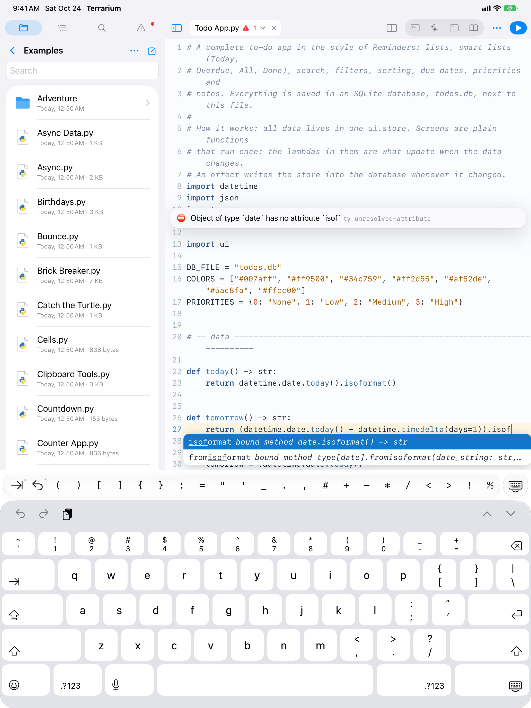</a>
</p>

<p>
  <a href="app/appstore/screenshots/duo/2-agent.png">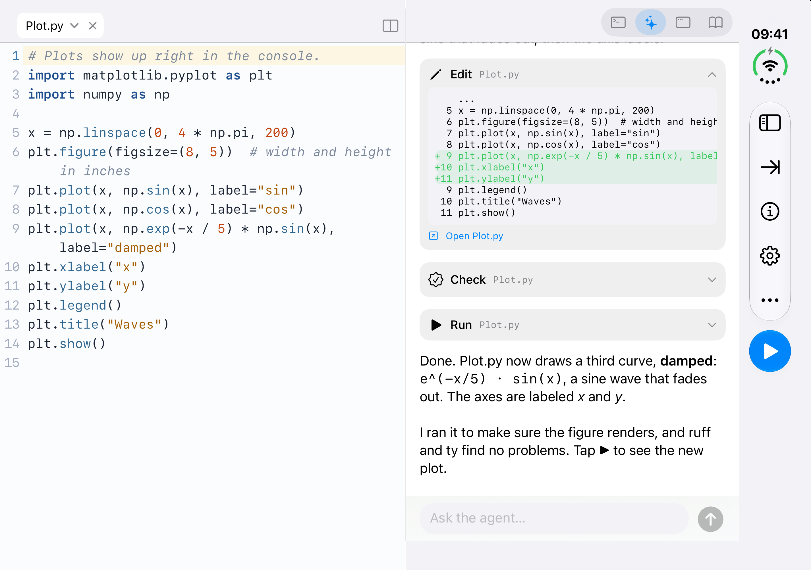</a>
  <a href="app/appstore/screenshots/duo/1-app.png">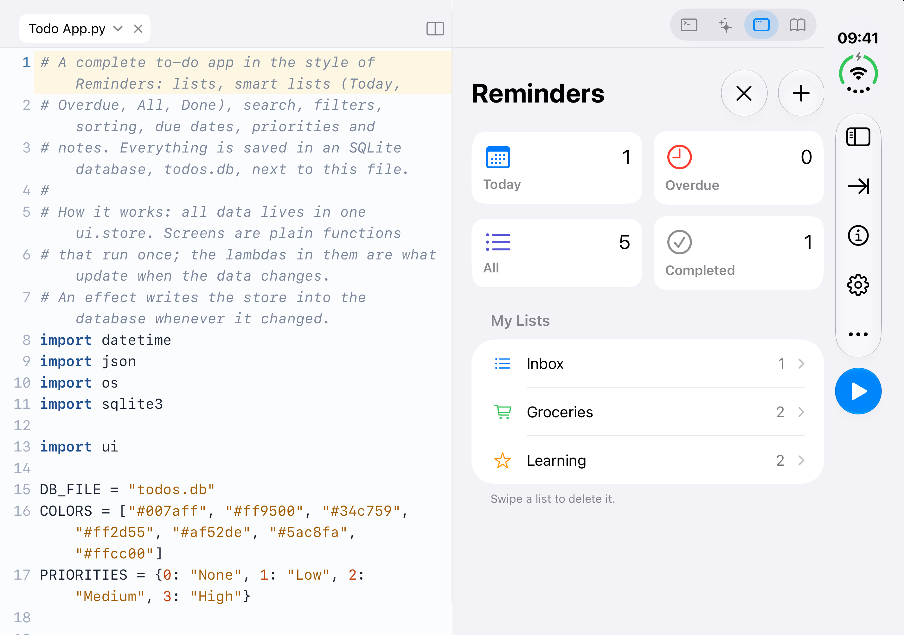</a>
</p>

<sub>The App Store screenshots (all of them: <a href="app/appstore/screenshots">app/appstore/screenshots</a>),
from <code>app/scripts/store-screenshots.sh</code> in the iPhone 18 Pro Max,
iPad Pro 13-inch (M5) and iPhone Duo simulators, iOS 27. The agent's replies
there are scripted; its tools really ran.</sub>

## Features

- **Python on the device**: CPython 3.14 through Pyodide, and a 3.15
  preview. A streaming console with `input()` and a `>>>` prompt, inline
  matplotlib plots, tracebacks drawn as frames that link to the line, and a
  Stop that always works. `multiprocessing` and `subprocess` run each
  process in a worker of its own.
- **Packages**: numpy, pandas, matplotlib and the rest of Pyodide's packages,
  plus pure-Python packages from PyPI. They are declared with PEP 723
  (`# /// script`, as with `uv run`) and cached for offline use.
- **Editor**: CodeMirror with a key bar for touch typing, tabs, split view,
  outline, go to line, find in folder, themes, and hardware keyboard
  shortcuts.
- **Notebooks and Markdown**: Jupyter notebooks and `# %%` cells run in a
  kernel with rich output (plots, pandas tables, HTML). Markdown files show
  as a preview, with links between files.
- **Code intelligence**: [ruff](https://github.com/astral-sh/ruff) (lint and
  format) and [ty](https://github.com/astral-sh/ty) (type checking,
  completions, go to definition) run locally as WebAssembly.
- **Debugger**: breakpoints, stepping, variables, a `>>>` prompt in the paused
  frame, and inspecting the frames after an error.
- **Native apps from Python**: the `ui` module builds SwiftUI screens, lists,
  sheets, inputs and canvases with Solid-style signals. Turtle graphics draw
  right in the console. Home Screen shortcuts run a program.
- **The device from Python**: Pythonista's `clipboard`, `dialogs`,
  `photos`, `location`, `motion`, `sound`, `speech`, `reminders` and
  more.
- **Documentation**: the Python docs of both versions and the app's own
  modules, offline, with search; `help()` opens them.
- **Layouts**: on iPad and the open iPhone Duo, one top row, a sidebar
  with files, outline, find and problems, and the other half next to the
  code: console, agent, the running app or the docs. On the Duo the fold
  divides them.
- **Files**: the app's Documents folder (also in the Files app) and linked
  folders from iCloud Drive or other apps. Programs read and write them, with
  `sqlite3` and all.
- **HTTP**: `requests`, `httpx` and `urllib` without CORS limits.
- **Coding agent**: built on
  [pi-durable](https://github.com/earendil-works/pi/tree/main/packages/durable).
  - It works on the folder you are in and knows which file you have open.
  - It reads, writes and edits files, runs Python, and checks and formats
    code with ruff and ty.
  - Conversations survive crashes and relaunches.
  - Sign in with Radius, Claude Pro/Max, ChatGPT, GitHub Copilot and others,
    or use an API key. Credentials stay in the Keychain.

## Building

```sh
make iphone-sim       # build and launch in an iPhone simulator (IPHONE="iPhone 17" picks one)
make ipad-sim         # the same in an iPad simulator (IPAD="iPad mini (A17 Pro)")
make device           # on a paired, unlocked iPhone
make selftest         # end-to-end checks in the iPhone simulator
```

The targets run `app/run.sh`, which also takes these as flags
(`--device`, `--selftest`, `--reset`).

You need Xcode 27, Node, [uv](https://docs.astral.sh/uv/), and Rust with
`wasm-pack` (ty has no published WebAssembly build). More is in
[`app/README.md`](app/README.md). How it is put together and why is in
[`docs/architecture.md`](docs/architecture.md), and every decision is in
[`DECISIONS.md`](DECISIONS.md).

## License

[Apache License 2.0](LICENSE).

## Credits

- **[Pythonista](https://omz-software.com/pythonista/)** by Ole Zorn is the
  inspiration. It showed years ago what Python on iOS should feel like.
- **Built on:**
  - [Pyodide](https://pyodide.org/), [CPython](https://www.python.org/) and
    [Emscripten](https://emscripten.org/);
  - [CodeMirror](https://codemirror.net/);
  - [ruff, ty and uv](https://astral.sh/) by Astral;
  - [SolidJS](https://www.solidjs.com/), whose model the `ui` module copies;
  - [pyodide-http](https://github.com/koenvo/pyodide-http);
  - matplotlib, numpy, pandas and the rest of the scientific Python stack.
- **Built with:** [pi](https://github.com/earendil-works/pi), the agent
  harness by Earendil. The app's own agent uses its pi-durable and pi-ai
  packages.
